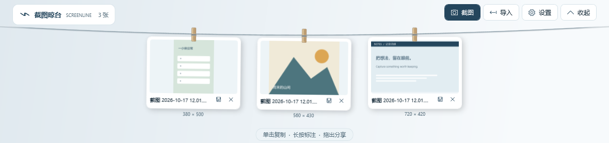

# 截图晾台 · Screenline for Windows

把截图挂在屏幕上沿，随手复制、预览、标注或拖出使用。

Screenline 受 [Tendedero](https://github.com/alejandrobujan/tendedero) 启发，以 C#、WPF 和 Windows API 重新实现截图晾台交互，面向 **Windows 10 / 11 x64**。项目使用独立名称和图标。

**[下载 Windows 版](https://github.com/xiaogao007/screenline-windows/releases/latest)** · [版本记录](https://github.com/xiaogao007/screenline-windows/releases) · [Windows 使用与常见问题](docs/WINDOWS.md)



## 下载与运行

1. 打开 [Releases](https://github.com/xiaogao007/screenline-windows/releases/latest)，在 **Assets** 中下载 **Screenline-vX.Y.Z-windows-x64.zip**，其中 `X.Y.Z` 为该版本号。`Screenline-vX.Y.Z-source.zip` 和 GitHub 自动生成的 `Source code` 压缩包仅含源码。
2. 将 ZIP **完整解压**到一个固定文件夹，保留 `Screenline.exe` 旁边的 `Screenline.exe.config`。
3. 双击 **Screenline.exe**。应用出现在系统托盘，首次展开后会自动收起。
4. 按 **Ctrl + Alt + T**，或将鼠标停在显示器顶边约 350 ms，即可展开晾台。右键托盘图标可打开设置或退出。

需要 **.NET Framework 4.8**；Windows 11 已内置，较新的 Windows 10 通常也已安装。运行程序不需要 Node、Python、.NET SDK 或管理员权限。

程序尚未代码签名，未提供安装器或自动更新。下载校验、运行问题与升级方法见 [Windows 使用说明](docs/WINDOWS.md)。

## 快捷键与操作

| 操作 | 结果 |
|---|---|
| **Ctrl + Alt + T** | 展开 / 收起晾台 |
| **Ctrl + Alt + S** | 拖选区域截图，Esc 取消 |
| 单击图片 / 卡片获焦后按 Enter、Space | 复制完整图片与文件引用 |
| 双击图片 | 打开原图预览 |
| 长按图片约 500 ms | 画笔标注；保存新副本 |
| 拖进应用或文件夹 | 复制图片，晾台仍保留 |
| 卡片保存图标 / 右键“另存图片” | 选择位置保存副本 |
| 卡片叉号 / 卡片获焦后按 Delete | 移出晾台，原图及本地副本保留 |
| **Ctrl + Z** / 托盘“撤销移出” | 恢复上次移出的图片，重启后也可撤销 |
| 晾台内按 Esc | 收起晾台 |

可直接把图片文件拖到晾台，或点击“导入”。支持 PNG、JPG/JPEG、BMP 和 GIF（静态帧）；单图最大 100 MB、1 亿像素。导入时按文件内容去重。拖出是否被接收取决于目标应用的图片或文件拖放支持。

## 自动收集与设置

默认只监听图片目录的 `Screenshots` 子文件夹及可用的 OneDrive 截图目录。**只收集启动监控后新增的图片，不会扫描导入旧文件。** 可以在设置中添加实际的截图保存目录。系统截图工具的保存位置不一致时，请在设置中选择它。

“收集剪贴板中的纯图片”默认关闭。手动开启后，可以收集 Win + Shift + S 等工具复制的新截图；含文字、文件或私密标记的混合内容会跳过。托盘“粘贴剪贴板图片”也支持主动导入，不需要开启后台剪贴板监控。

当其他应用占用快捷键时，会提示从托盘操作。全屏时默认抑制自动展开，手动快捷键和托盘入口仍可用。

## 本地数据与隐私

应用没有网络请求、账户和统计。图片、设置、日志存放在 `%LOCALAPPDATA%\Screenline`；导入时建立自己的副本，不修改或删除外部源文件。

移出晾台只更新可恢复记录，**不会释放图片占用的磁盘空间，也不会自动送进 Windows 回收站**。托盘“打开本地图库”可查看图片文件。需要清理时先退出程序，再备份或整理该目录；自行删除后，相应图片将无法恢复。

“登录 Windows 后启动”默认关闭，勾选保存后才写入当前用户的启动项。启用后请不要移动 EXE；移动后可取消再重新勾选。

## 从源码构建

在 Windows x64 上安装 .NET Framework 4.8，然后用 Windows PowerShell 打开仓库根目录：

```powershell
powershell -NoProfile -ExecutionPolicy Bypass -File .\build.ps1
powershell -NoProfile -ExecutionPolicy Bypass -File .\build.ps1 -Test
```

第一条命令构建根目录的 `Screenline.exe`，第二条重新构建并运行自检。脚本使用 Windows 的 .NET Framework C# 编译器，不下载依赖。命令中的执行策略仅作用于本次 PowerShell 进程，不会永久更改系统策略。

源码位于 [`src`](src)，兼容 C# 5。也可以使用安装了 .NET Framework 桌面开发工具的 Visual Studio 打开 [`Screenline.csproj`](Screenline.csproj)。

自检只使用合成图片及隔离测试目录，不读取或改写系统剪贴板。覆盖导入去重、持久化、移除撤销、损坏索引恢复、原子保存失败、文件监控、隐私过滤、选区边界、原图尺寸保留及 WPF 渲染。测试报告与界面预览生成在 `tests/results`。

## 自动构建与发布

向 GitHub 推送 `vX.Y.Z` 版本标签后，[Windows Release 工作流](.github/workflows/release.yml) 会在 Windows runner 上构建程序、执行 `build.ps1 -Test` 自检，并打包便携程序、对应标签源码及 `SHA256SUMS.txt`。只有构建、自检、打包与附件上传均成功，才会公开 Release。已有的正式发布不会被覆盖。

也可以在仓库的 [Actions](https://github.com/xiaogao007/screenline-windows/actions) 页面手动运行工作流；手动运行仅构建、自检并保存产物，不创建 Release。标签发布步骤、权限与失败重试方法见 [维护者发布说明](docs/RELEASING.md)。

## 当前范围与限制

当前仍处于 Windows 功能迁移的早期阶段，尚未与上游完整对齐。未实现录屏、视频裁剪、Force Touch、拖到回收站删除、自定义快捷键、尺寸档位和数量上限。采用原生 WPF 白色相框和木夹；没有移植 macOS 液态玻璃效果。混合 DPI、多显示器热插拔、游戏独占全屏、屏幕阅读器及 ARM64 尚未完成实机验证。

更多行为差异见 [Windows 平台迁移说明](docs/MIGRATION.md)。遇到问题时，可在 GitHub 提交 Issue，附上 Windows 版本、显示器缩放比例、复现步骤和日志中与问题有关的内容；提交前请检查截图、路径等个人信息。

## 许可证与来源

Screenline 源码以 [MIT 许可证](LICENSE) 发布。感谢 Alejandro Buján 的 [Tendedero](https://github.com/alejandrobujan/tendedero) 提供交互灵感；本项目不是其官方 Windows 版本，也未获得原作者背书。

上游源码采用 MIT 许可证；上游的名称、图标及文档图片不在其代码许可的授权范围内，本项目未将它们作为自己的资产分发。完整上游许可和来源见 [THIRD-PARTY-NOTICES.txt](THIRD-PARTY-NOTICES.txt)。
